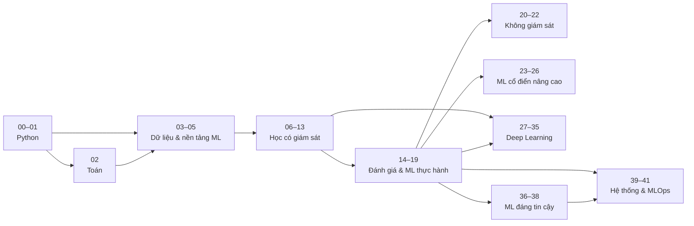

# 🧭 Lộ trình học

Khoá học có 42 chương chia thành 10 giai đoạn. Bạn **không** bắt buộc học hết theo thứ tự — chọn lộ trình theo mục tiêu, nhưng tôn trọng các **chương nền** (mũi tên dưới đây).

## Sơ đồ phụ thuộc

| Giai đoạn | Chương | Thời lượng gợi ý | Đầu ra |
|---|---|---|---|
| 1 · Foundations | 00–01 | 3 tuần | Python, NumPy, pandas, Matplotlib thành thạo; môi trường sẵn sàng |
| 2 · Mathematics | 02 | 2 tuần | đại số tuyến tính, gradient, xác suất, MLE/MAP đủ để đọc công thức ML |
| 3 · Data & ML Fundamentals | 03–05 | 4 tuần | EDA, tiền xử lý, pipeline; hiểu overfitting, rò rỉ, dịch chuyển phân phối |
| 4 · Supervised Learning | 06–13 | 8 tuần | tự cài và dùng thành thạo các mô hình kinh điển |
| 5 · Evaluation & Practical ML | 14–19 | 4 tuần | đánh giá đúng, tinh chỉnh, đặc trưng, mất cân bằng — kỹ năng phân biệt người làm ML "thật" |
| 6 · Unsupervised Learning | 20–22 | 2 tuần | phân cụm, giảm chiều, phát hiện bất thường |
| 7 · Advanced Classical ML | 23–26 | 3 tuần | mô hình xác suất, ensemble, chuỗi thời gian, hệ gợi ý |
| 8 · Deep Learning | 27–35 | 9 tuần | mạng nơ-ron từ đầu → PyTorch (và TensorFlow/Keras) → CNN trên ảnh thật, Transformer, NLP, CV, học biểu diễn, RL |
| 9 · Trustworthy ML | 36–38 | 3 tuần | giải thích mô hình, bất định và hiệu chỉnh, suy luận nhân quả |
| 10 · ML Systems & MLOps | 39–41 | 6 tuần | hệ thống ML, MLOps, project 08, capstone từ dữ liệu thô đến giám sát |

Lịch đầy đủ 44 tuần: [SCHEDULE.md](SCHEDULE.md).

## Lộ trình theo mục tiêu

### 🎯 Lộ trình đầy đủ — "từ số 0 đến nâng cao" (~44 tuần)

Mọi chương theo thứ tự trong [SCHEDULE.md](SCHEDULE.md), 8 project, capstone, 6 bài thi. Dành cho người mới hoặc muốn nền tảng vững nhất.

### 📊 Data Scientist (~26 tuần)

Trọng tâm: phân tích, mô hình bảng, đánh giá chặt chẽ, nhân quả, truyền đạt.

| Phần | Chương | Project / thi |
|---|---|---|
| Nền tảng | 00–05 | bài thi 1 |
| Mô hình | 06, 07, 10, 11, 12 (lướt 08, 09, 13) | project 01, 02 |
| Thực hành | 14–19 | bài thi 3 |
| Không giám sát & chuỗi thời gian | 20, 21, 25 | project 03, 04 |
| Đáng tin cậy | 36, 37, 38 | — |
| Tổng kết | 41 (capstone) | capstone |

### 🛠️ ML Engineer (~28 tuần)

Trọng tâm: mô hình đủ tốt + hệ thống chạy được, tái lập, triển khai, giám sát.

| Phần | Chương | Project / thi |
|---|---|---|
| Nền tảng | 00–01, 02 (04–05), 03–05 | bài thi 1 |
| Mô hình | 06, 07, 10–12 | project 02 |
| Thực hành | 14–17, 19 | — |
| Ensemble & gợi ý | 24, 26 | project 05 |
| Deep learning cốt lõi | 27, 28, 29 hoặc 31 | — |
| Đáng tin cậy | 37 | — |
| Hệ thống | 39, 40, 41 | **project 08**, capstone, bài thi 6 |

### 🧠 Deep Learning (~22 tuần, cần nền ML cơ bản)

| Phần | Chương | Project / thi |
|---|---|---|
| Ôn nhanh (làm checkpoint, chỉ học lại phần REVIEW) | 01, 02, 05, 07, 14, 15 | — |
| Deep learning | 27–35 | project 06, 07, bài thi 5 |
| Bổ sung | 36 (giải thích), 37 (bất định), 39 (tái lập, đóng gói) | — |

### ⚡ Lộ trình cấp tốc — đã có nền tảng (8–12 tuần)

Dùng checkpoint như **bài kiểm tra vượt cấp**: với mỗi chương, làm `99_checkpoint.ipynb` **trước**. PASS → chuyển chương; REVIEW → chỉ học các bài được liệt kê ở "chủ đề yếu". Ưu tiên các chương mà ngay cả người có kinh nghiệm hay hổng: 05 (rò rỉ, dịch chuyển), 14–15 (đánh giá, CV), 19 (chi phí), 37 (calibration), 38 (nhân quả), 39–40 (hệ thống). Kết thúc bằng project 08 và capstone.

## Sau khoá học

- Làm capstone với dữ liệu thật trong lĩnh vực bạn quan tâm; đưa lên portfolio cùng báo cáo, model card, demo.
- Tham gia một cuộc thi (Kaggle) **sau khi** đã quen đánh giá chặt chẽ — dùng nó để luyện kỹ thuật, không để học tư duy.
- Đọc paper gốc của các phương pháp đã học ([references/papers.md](references/papers.md)); tái hiện một paper nhỏ.
- Đóng góp lại cho khoá học ([CONTRIBUTING.md](CONTRIBUTING.md)).
